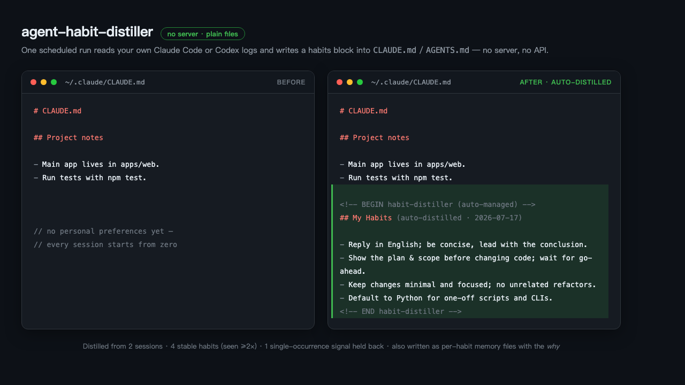

# claude-habit-distiller

**The more you use Claude Code, the more it knows you. 100% local — no server, no API, no data leaves your machine.**

`claude-habit-distiller` is a scheduled *reflection job* for [Claude Code](https://claude.com/claude-code).
Once a day it reads your own local conversation logs, distills the **stable habits
and preferences** you've shown across sessions, and writes them back into:

- a **"My Habits" block** in your global `CLAUDE.md` (loaded into every future session), and
- a set of **per-habit memory files** with the *why* behind each one.

You don't teach it your preferences. It notices them.



## What makes it different

Most "AI memory" projects are **memory infrastructure** — SDKs + vector DBs you
wire into an agent *you* build. This is the opposite: zero infrastructure, pure
files, aimed at Claude Code itself.

| | This tool | Mem0 / Zep / Letta | Claude Code native auto-memory |
|---|---|---|---|
| What it is | Offline **reflection / profiler** | Runtime memory **store** | In-session note-taking |
| Runs | On a schedule, batch | On every agent turn | Opportunistically mid-session |
| Scope | **Cross-project, about *you*** | Per-app, about anything | Per-project, about the repo |
| Infra | None (local files) | Vector DB / server / SDK | Built-in |
| Output | Human-editable `CLAUDE.md` + memory | API-queried embeddings | `MEMORY.md` notebook |

It's a *reflector*, not a *store*. It answers "who is this person and how do they
like to work" — then hands Claude a concise, hand-editable habits list.

## How it works

1. Determine the window since the last run (`.last-run`, or `window_days` on first run).
2. Scan every project's `*.jsonl` transcripts and `history.jsonl` in that window.
3. Distill only **stable, reusable** signals (default: seen ≥ 2 times) into four
   categories — `user`, `feedback`, `project`, `reference`.
4. Write per-habit files into the **ledger** (dedup, keep superseded history).
5. Run a rotating **staleness audit** — the only path by which anything is ever removed.
6. Rewrite the sentinel-managed **habits block** in `CLAUDE.md` within a character
   budget, under a zero-net-growth rule (leaving the rest of the file untouched).
7. Update `.last-run` and print a short summary.

### Two layers, on purpose

The habits block in `CLAUDE.md` is loaded **in full, on every single turn** — so it
is budgeted and holds decision rules only. The ledger is read on demand and holds
the Why: evidence, cases, dates, numbers, and how a belief was overturned. Every
line in the block can carry a `→slug` pointer to its ledger file, which is what
makes it safe to keep the block short.

Without that split, the block only ever grows. In one real 98-day run it went from
13 entries to 51 and from a few KB to ~105,000 characters, with zero deletions —
because a scheduled job only ever sees *today's* new material, and nothing ever
tells it to re-examine what's already there. Hence the staleness audit and the
character budget.

See [`docs/how-it-works.md`](docs/how-it-works.md) for the full design and
[`examples/`](examples/) for a before/after `CLAUDE.md`.

## Install (30 seconds)

```bash
git clone https://github.com/betayyang/claude-habit-distiller.git
cd claude-habit-distiller
cp config.example.toml ~/.config/claude-habit-distiller/config.toml   # optional; edit to taste
./install/install.sh                 # links the skill + schedules a daily run
```

- **macOS**: schedules via `launchd`. **Linux**: via `cron`.
- Pick a time: `./install/install.sh --hour 21 --minute 30`
- Skip scheduling (skill only): `./install/install.sh --no-schedule`
- Requires the `claude` CLI on your `PATH`.

Run it manually anytime:

```bash
~/.claude/skills/distill-habits/run.sh        # headless, updates everything
# or, inside an interactive Claude Code session:
/distill-habits
```

Uninstall (leaves your memory + habits block in place):

```bash
./install/uninstall.sh
```

## Configuration

All knobs live in `~/.config/claude-habit-distiller/config.toml` (see
[`config.example.toml`](config.example.toml)): language, look-back window,
stability threshold, character budget, whether to write the global block, project
exclusions, and ledger location.

Two notes if you installed an earlier version:

- **`max_habits` is deprecated**, replaced by `max_block_chars` / `max_entry_chars`.
  Capping the *line count* is the wrong axis — the model just grows the existing
  lines instead, so the count stays compliant while single entries balloon.
- **The ledger moved** from `~/.claude/projects/<home-project>/memory/` to
  `~/.claude/knowledge/habits/`. The old location is isolated per project directory,
  so any session started from a git worktree or a second checkout got an empty one
  and could never read back what had been distilled. The skill migrates an existing
  install automatically on its next run and leaves a pointer file behind.

## Optional: notify on each run

Set `HABIT_DISTILLER_WEBHOOK` to a URL and the runner will POST a
`{"text": "..."}` summary after each run (Slack/Discord/Feishu-compatible).
Unset by default — nothing is sent anywhere.

## Privacy

This tool reads **only your local files** under `~/.claude` and makes **no network
requests** (unless you opt into the webhook above). It never uploads your
conversations. Because it reads your entire conversation history, review
[`PRIVACY.md`](PRIVACY.md) and decide how sensitive your local logs are before use.

## License

MIT — see [LICENSE](LICENSE).
